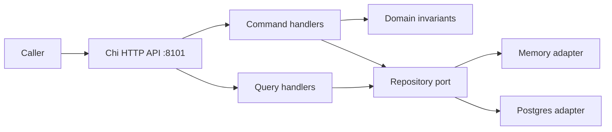

# Double-Entry Ledger

A synthetic-only CQRS ledger for exact-money journals, idempotent posting, append-only reversals, and auditable balances. It handles no real funds, payment traffic, credentials, or personal data.

[](https://github.com/TuanKietTran/double-entry-ledger-go/actions/workflows/ci.yml) **Hosted workflow: not yet verified.**

## Quickstart

Requires Go 1.25 or newer. Docker is not required for the memory-backed server. The following three commands clone, test, and run it:

```sh
git clone https://github.com/TuanKietTran/double-entry-ledger-go.git
cd double-entry-ledger-go && go test ./...
go run ./cmd/server
```

The server listens on `127.0.0.1:8101`. Set `HTTP_ADDR` to another loopback host/port to change the listener; non-loopback addresses are rejected. Set `DATABASE_URL` to use PostgreSQL; apply `migrations/001_init.sql` and `migrations/002_reversals.sql` before starting (migrations are not applied automatically).

## Architecture



The server wires transport, command/query handlers, domain rules, and memory or PostgreSQL persistence. The ledger consumes no downstream service.

## API examples

Provision accounts, then post one balanced journal. Replace IDs with UUIDs of accounts you provisioned.

```sh
curl -i http://127.0.0.1:8101/v1/accounts -H 'Content-Type: application/json' -d '{"account_id":"11111111-1111-4111-8111-111111111111","currency":"USD","type":"ASSET"}'
curl -i http://127.0.0.1:8101/v1/accounts -H 'Content-Type: application/json' -d '{"account_id":"22222222-2222-4222-8222-222222222222","currency":"USD","type":"EQUITY"}'
curl -i http://127.0.0.1:8101/v1/transactions -H 'Content-Type: application/json' -d '{"idempotency_key":"demo-001","entries":[{"account_id":"11111111-1111-4111-8111-111111111111","amount":"12.34","direction":"DEBIT","currency":"USD"},{"account_id":"22222222-2222-4222-8222-222222222222","amount":"12.34","direction":"CREDIT","currency":"USD"}]}'
curl -i 'http://127.0.0.1:8101/v1/accounts/11111111-1111-4111-8111-111111111111/entries?limit=50'
```

The complete request, response, and status contract is [`api/openapi.yaml`](api/openapi.yaml). A repeated idempotency key with the same payload replays the original result; changed payloads conflict. Entry scans support legacy `offset` pagination and cursor continuation via `X-Next-Cursor`.

## Operations and configuration

- `HTTP_ADDR`: loopback listener address (default `127.0.0.1:8101`); non-loopback hosts are rejected.
- `DATABASE_URL`: optional PostgreSQL URL; unset selects in-memory storage.
- `/healthz`, `/readyz`, `/metrics`: health and metrics endpoints.
- HTTP errors use a JSON envelope and `X-Request-ID`; request bodies are bounded.

## Verification and measured status

On 2026-10-19, Go 1.27.2, Windows/amd64, `go test -p 2 ./... -race -count=1 -cover` passed: API 89.5%, command 94.4%, domain 93.7%, playback 76.5%, query 94.1%, repository 80.3%, serverruntime 87.5%. `go test -p 2 ./... -race -count=1 -coverpkg=./internal/... -coverprofile=<profile>` followed by `go tool cover -func=<profile>` measured weighted internal statement coverage at 87.5% (the profile path is chosen by the caller). The same revision passed `gofmt -l .` (no output), `go build ./...`, and `go vet ./...`.

`go test -p 1 ./internal/playback -run '^TestR1' -count=1 -v` exercised 10,000 submissions against the production router over loopback, including 200 identical same-key duplicates and injected transient responses/timeouts; it completed in 8.4868559s with 9,800 unique effects and balanced trial-balance state. This is a bounded in-memory test, not a deployment or sustained-throughput claim. See [`openspec/dod.md`](openspec/dod.md) for Met/Partial/Unmet status and named evidence.

## Design decisions

See the [ADR index](docs/adr/README.md) for CQRS, exact money, idempotency, resilience scope, and persistence/testing trade-offs.

## Glossary

- **Journal/transaction:** immutable set of entries whose debits equal credits.
- **Entry:** positive exact-decimal amount, account, currency, and strict debit/credit direction.
- **Reversal:** a new transaction with inverted legs, preserving the original history.
- **Idempotency key:** caller identity bound to a canonical write payload.
- **Trial balance:** per-account debit-minus-credit amount; different currencies are not combined.

## Platform family

This is one synthetic service in a five-service demonstration platform: [payments](https://github.com/TuanKietTran/payment-orchestration-go), [fraud](https://github.com/TuanKietTran/fraud-detection-go), [loans](https://github.com/TuanKietTran/loan-platform-go), and [portfolio](https://github.com/TuanKietTran/portfolio-tracker-go). No service handles real money or real customer data.

## Limitations

Memory storage is not durable. PostgreSQL is available, but deployment, remote-database fault recovery, hosted CI execution, and sustained live-process load are not claimed. The CI workflow is authored but has not been verified on GitHub. This ledger has no downstream service, so downstream retry/outbox behavior is not applicable.
