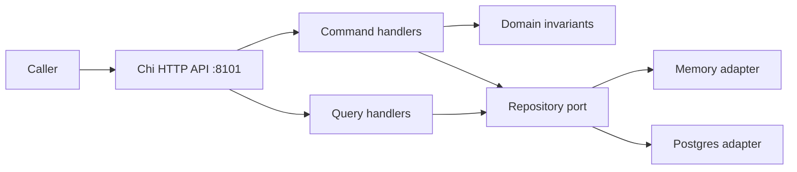

# Double-Entry Ledger

A synthetic-only ledger service demonstrating exact-money journals, explicit account provisioning, append-only corrections, idempotent writes, and CQRS reads. It processes no real funds, PSP traffic, credentials, or PII.

## Architecture



`cmd/server` wires `internal/api`, `command`, `query`, domain, and repository adapters. Reads and writes share the repository boundary; there is no downstream service dependency.

## Run

Go 1.22+; Docker is not required. With `DATABASE_URL` unset the server uses memory. With it set the server uses Postgres; apply `migrations/001_init.sql` and `migrations/002_reversals.sql` to that database first (the server does not run migrations). Default listener is `:8101`; override with `HTTP_ADDR`.

```sh
go test ./...
go run ./cmd/server
```

Create two accounts, then post a balanced exact-decimal transaction (use UUIDs you provision):

```sh
curl -i localhost:8101/v1/accounts -H 'Content-Type: application/json' -d '{"account_id":"11111111-1111-4111-8111-111111111111","currency":"USD","type":"ASSET"}'
curl -i localhost:8101/v1/accounts -H 'Content-Type: application/json' -d '{"account_id":"22222222-2222-4222-8222-222222222222","currency":"USD","type":"EQUITY"}'
curl -i localhost:8101/v1/transactions -H 'Content-Type: application/json' -d '{"idempotency_key":"demo-001","entries":[{"account_id":"11111111-1111-4111-8111-111111111111","amount":"12.34","direction":"DEBIT","currency":"USD"},{"account_id":"22222222-2222-4222-8222-222222222222","amount":"12.34","direction":"CREDIT","currency":"USD"}]}'
curl -i localhost:8101/v1/accounts/11111111-1111-4111-8111-111111111111/balance
```

Full request/response shapes and statuses are authoritative in [`api/openapi.yaml`](api/openapi.yaml). Writes require explicit account provisioning. Same idempotency key and same payload replays the original result; a changed payload conflicts. Optional `expected_versions` checks account versions.

## API and operations

Current routes: account provision/read, transaction post/lookup by ID or idempotency key, reversal, account entries and current/as-of balance, trial balance. `/healthz`, `/readyz`, and `/metrics` are operational endpoints. HTTP errors use a JSON envelope and `X-Request-ID`. `DATABASE_URL` is optional; `HTTP_ADDR` defaults to `:8101`.

## Glossary

- **Journal/transaction:** immutable group of entries whose debits equal credits.
- **Entry:** positive exact decimal amount, account, currency, and strict DEBIT/CREDIT direction.
- **Reversal:** a new transaction with inverted legs, preserving the original.
- **Idempotency key:** caller identity for a write, bound to its canonical payload.
- **Trial balance:** per-account debit-minus-credit total; unlike currencies are not combined.

## Measured status

Evidence from `go test -p 2 ./... -race -count=1 -cover` on 2026-10-18 with Go 1.27.1, macOS arm64 (non-root): API 90.7%, command 94.7%, domain 93.7%, playback 63.5%, query 100.0%, repository 85.2%, cmd 43.1%. Embedded PostgreSQL tests also passed in this macOS run. `TestPostgresLedger` (embedded Postgres, seven subtests) was run natively on Windows with `go test -p 2 ./internal/repository -run TestPostgresLedger -race -count=1 -v` and passed (28.03s, 2026-10-18; log in the control folder under `logs/ledger/pg-worker-run.txt`). The test skips only when the process runs as root (`os.Geteuid()==0`), which does not apply to that run. The subsequent macOS command `go test -p 2 ./internal/repository -run TestPostgresLedger -race -count=1 -v` passed (49.005s, 2026-10-18), including independent-connection replay, changed-payload/version conflicts, competing reversals and timestamp-tied pagination. Tests assert balances equal entry folds and only committed writes advance versions. This is bounded concurrency evidence, not exhaustive database failure testing. These package percentages are not an aggregate; weighted internal coverage was measured at 87.6% with `go test -p 2 ./... -race -count=1 -coverpkg=./internal/... -coverprofile=/tmp/ledger-macos-concurrency.cover` and `go tool cover -func=/tmp/ledger-macos-concurrency.cover`. Response contract tests check published property sets, required fields and representative handler bodies (JSON types/enums/references); they are not a complete OpenAPI semantic validator.

## Design decisions

See [ADRs](docs/adr/). This repository demonstrates domain-first money invariants, CQRS boundaries, payload-bound idempotency, optimistic versions, and memory/Postgres adapter parity; it does not claim production deployment, external-service resilience, or independently measured live-process performance.
